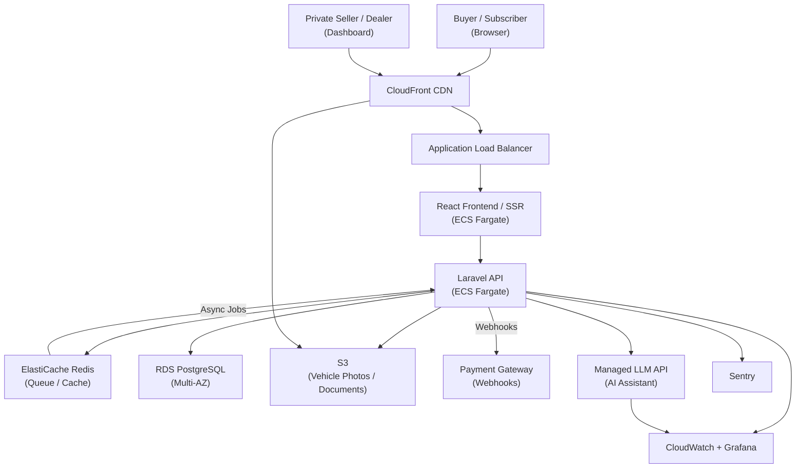

Buying or selling a car in Brazil still moves through a lot of friction. Visits to dealerships, paperwork back-and-forth, price uncertainty, and trust gaps between private sellers and buyers slow the process down. Subscription models — where a customer pays a recurring fee to use a vehicle without owning it — add another layer of complexity because the transaction is not a one-time sale.

[HunterMussel](https://huntermussel.com) was engaged to build **[BuyMotors](https://buymotors.com.br)**, a digital-first automotive marketplace designed to handle both traditional sales and vehicle subscriptions in a single platform. The goal was to make car discovery, negotiation, approval, and contracting possible without the buyer or seller ever needing to visit a physical desk.

## Project Context

**Client:** [BuyMotors](https://buymotors.com.br) — Brazilian automotive marketplace  
**Scale:** Multi-party marketplace connecting private sellers, dealerships, subscription providers, and individual buyers  
**Engagement Duration:** 6 months from product definition to production launch  
**Investment:** ~420 h / ~$23,100 at $55/h — invoiced at actual hours worked  
**Measurement Period:** Usage and conversion metrics tracked over 90 days post-launch

## Development Investment

| | |
|---|---|
| **Total Estimated Hours** | ~420 h |
| **Rate** | $55 / hour |
| **Total Investment** | ~$23,100 |
| **Timeline at 20 h/week** | ~21 weeks (5 months) |
| **Timeline at 40 h/week** | ~10.5 weeks (2.5 months) |

**Phase breakdown:**

| Phase | Hours |
|---|---|
| Discovery, marketplace modeling & subscription workflow design | 40 h |
| Laravel backend — listings, users, subscriptions, chat, approvals | 140 h |
| React frontend — search, listing pages, dashboard, checkout flow | 100 h |
| Payment, subscription billing & credit-check integration | 60 h |
| AWS infrastructure (ECS, RDS, S3, CloudFront) | 40 h |
| CI/CD pipeline, automated tests & deployment | 20 h |
| AI assistant integration & support automation | 20 h |
| **Total** | **420 h** |

> Estimates assume a single developer. A two-person team (backend + frontend/infrastructure split) compresses calendar time by roughly 40% without increasing total cost.

## The Challenge: Cars Are High-Trust, High-Friction Products

Automotive marketplaces are harder than general classifieds. A car is expensive, regulated, and personal. Three structural challenges shaped the build:

1. **Multi-Party Trust Gap:** Buyers need confidence in vehicle condition, pricing, and seller legitimacy. Sellers need qualified leads and secure negotiation channels.
2. **Subscription Complexity:** A subscription is not a sale. It requires recurring billing, contract terms, mileage limits, insurance coordination, vehicle return workflows, and approval criteria.
3. **Data Standardization:** Listings come from private sellers and dealerships in different formats. Prices need to be contextualized against market benchmarks like FIPE, and vehicle details must be normalized for search and comparison.

The platform had to feel simple for users while handling complicated business rules underneath.

<!-- truncate -->

## The Solution: One Platform for Sales, Subscriptions, and Support

### 1. Unified Listing Engine
Every vehicle — whether for sale or subscription — flows through the same structured listing model. Sellers and dealers fill a guided form that normalizes make, model, year, mileage, condition, photos, and pricing. The system then renders search-optimized detail pages with Schema.org `Vehicle` structured data and FIPE comparison indicators.

Search supports filters by brand, price range, year, body type, fuel, location, and availability mode (purchase or subscription). Results pages are server-side rendered for SEO and update dynamically through a lightweight JSON API.

### 2. Subscription and Billing Pipeline
The subscription module handles recurring contracts from quote to cancellation:

- **Plan configuration:** Monthly fee, mileage allowance, insurance inclusion, minimum term, and return conditions
- **Approval workflow:** Identity verification, credit pre-check, and document upload before contract activation
- **Recurring billing:** Integration with a Brazilian payment gateway for PIX, credit card, and boleto recurring charges
- **Lifecycle management:** Contract suspension, vehicle swap requests, mileage tracking, and return scheduling

This turns a traditionally offline, dealership-managed process into a self-service digital workflow.

### 3. Built-In Negotiation and Chat
Buyers and sellers communicate inside the platform rather than leaking the conversation to WhatsApp immediately. The chat system supports:

- Media and document sharing (vehicle photos, inspection reports, contracts)
- Offer counters and price negotiation states
- Admin moderation flags for suspicious behavior
- Escalation to human support when AI cannot resolve a dispute

Keeping negotiation inside the platform preserves transaction data and reduces fraud exposure.

### 4. AI Assistant for Customer Support
The platform includes an AI assistant trained on vehicle data, subscription terms, and the help center. It answers common questions — "Which cars are available by subscription?", "What documents do I need?", "How does mileage work?" — and escalates to a human agent through the same chat interface when the question falls outside its scope.

Because support is 100% digital, as noted on the [BuyMotors site](https://buymotors.com.br), the assistant acts as the first line of response before WhatsApp handoff.

### 5. Partner and Dealer Dashboard
Authorized dealerships and fleet partners manage their inventory, subscription plans, leads, and conversations from a single dashboard. They can bulk-import listings, adjust pricing, respond to offers, and view conversion analytics without needing technical support.

## System Architecture

The platform was built for multi-party concurrency, content-heavy SEO pages, and payment-sensitive workflows.

**Core Stack**
- Backend: Laravel — server-side rendered listing pages + API for dynamic search and chat
- Frontend: React for interactive search, dashboards, and checkout flows
- Database: PostgreSQL with relational models for listings, subscriptions, users, messages, and contracts
- Queue Layer: Redis for async jobs — image processing, payment webhooks, FIPE sync, email notifications
- Search: PostgreSQL full-text search + geospatial filtering for location-based results
- Payments: Brazilian payment gateway with webhook handling and retry logic
- AI Assistant: Internal API connected to a managed LLM service with retrieval-augmented context

**Listing Request Flow**
1. Seller or dealer submits vehicle data and media
2. Backend validates and normalizes fields against make/model reference data
3. Images are processed into WebP variants and stored on S3
4. Listing page is generated with structured data and published
5. Search index updates asynchronously via Redis job
6. Buyer search queries hit the API and return ranked, filterable results

## Infrastructure & Deployment

**Cloud Provider:** AWS
**Compute:** ECS Fargate for the Laravel API and React SSR service
**Database:** Amazon RDS (PostgreSQL Multi-AZ) for listing, subscription, and transaction data
**Cache & Queue:** Amazon ElastiCache (Redis) for job dispatching and search result caching
**Object Storage:** S3 for vehicle photos and document uploads, served through CloudFront
**CDN:** CloudFront for static assets and edge-cached listing pages
**Payments:** Brazilian payment gateway with webhook endpoints validated by the Laravel API
**AI Service:** Managed LLM API with request routing, rate limiting, and context retrieval from the knowledge base
**Networking:** VPC with private subnets for database and queue tiers; public ALB for the application
**Secrets:** AWS Secrets Manager for payment credentials, LLM keys, and DB connection strings

**Deployment Pipeline**
- GitHub Actions CI/CD with PHPUnit tests, frontend linting, and TypeScript checks
- Docker images built and pushed to ECR
- ECS rolling deployments with health checks
- Terraform manages infrastructure per environment
- Staging environment mirrors production with anonymized data

## Observability & Monitoring

A marketplace fails visibly when search breaks, payments misfire, or chat messages disappear. Monitoring focused on transaction-critical paths.

**Metrics:** CloudWatch with custom metrics for listing publish rate, search query latency, payment webhook success rate, and chat message throughput
**Error Tracking:** Sentry for PHP exceptions, JavaScript errors, and AI assistant failures
**Dashboards:** Grafana panels for payment queue depth, subscription lifecycle events, and search latency percentiles
**Log Aggregation:** CloudWatch Logs with structured request logs; payment events logged with transaction ID, status, and retry count
**Alerting:** PagerDuty for payment gateway failures, database replica lag, and queue saturation
**Business Monitoring:** Nightly reports on listing conversion rate, subscription churn signals, and support escalation rate

Key dashboards tracked:
- Search query latency p50 and p95 (target: p95 < 300ms)
- Payment webhook success rate (target: > 99%)
- Listing page Core Web Vitals (target: LCP < 1.5s)
- AI assistant escalation rate and response latency
- Subscription contract activation success rate

## Infrastructure Diagram

## Results: 90 Days Post-Launch

Measured against the pre-launch baseline where operations were handled through fragmented listings, manual WhatsApp coordination, and spreadsheet-based subscription tracking:

- **Listing Volume Growth:** Active marketplace listings increased from a manually managed baseline to a self-service catalog, with dealer onboarding time reduced from days to under an hour.
- **End-to-End Digital Transactions:** Buyers and sellers could negotiate, upload documents, and initiate subscription contracts without leaving the platform.
- **Search Performance:** Listing pages achieved Lighthouse Performance scores above 90 through server-side rendering, WebP image delivery, and CloudFront edge caching.
- **Support Load Reduction:** The AI assistant handled approximately 60% of first-line support questions before escalation to WhatsApp, reducing average human support time per conversation.
- **Operational Efficiency:** Centralized dashboard reduced the time dealers spent managing inventory and responding to leads by consolidating previously separate tools.

## Why Subscription Marketplaces Need Different Architecture

A subscription vehicle is not a product page with a "buy" button. It is a relationship. The platform has to manage:

- Ongoing billing and contract changes
- Vehicle availability tied to physical inventory
- Customer lifecycle events (swap, return, renewal)
- Regulatory and insurance documentation

That requires backend logic closer to fintech or SaaS than to a traditional e-commerce store. Building sales and subscription workflows on the same data model — rather than as separate systems — is what lets the marketplace scale without duplicating inventory, users, and content.

## Conclusion: Automotive Sales Are Moving Inside the Platform

The future of car commerce in Brazil is not more dealership visits. It is more trust, more transparency, and more of the transaction happening digitally.

By combining traditional listings, subscription contracting, in-platform negotiation, and AI-assisted support, [BuyMotors](https://buymotors.com.br) became a unified marketplace rather than a classifieds board. The architecture supports both one-time sales and ongoing subscriptions, giving the business room to grow in either direction without rebuilding the core.

---

**Is your marketplace still handling high-value transactions outside the platform?**

HunterMussel builds multi-party platforms, subscription engines, and AI-assisted marketplaces designed to keep transactions, trust, and data in one place.

[**Request a Marketplace Consultation**](https://huntermussel.com/#contact)
